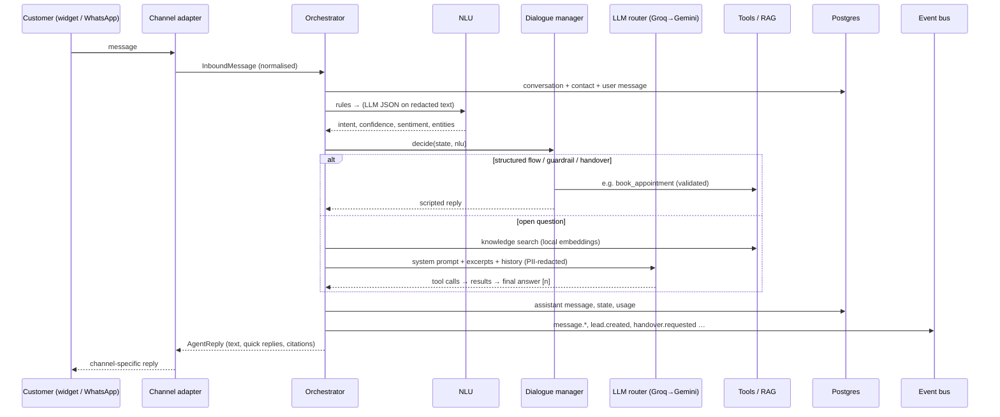

# AgentGrid architecture

This document covers the components, data model, request flow, multi-tenancy, security, the scaling plan, and how the proof of concept (PoC) maps to the phases in the RFP pre-read.

## 1. Components

AgentGrid ships as **one Python service** (FastAPI). It is deployed as an API process and, optionally, a separate worker process. The same container image runs locally, in Docker Compose, on Render, on ECS Fargate and on Kubernetes.

| Layer | Module | Responsibility |
|---|---|---|
| Channels | `app/channels`, `app/api/widget.py`, `app/api/webhooks.py`, `app/api/v1/channels.py` | Web widget (HTTP + WebSocket), REST API, WhatsApp and Messenger webhooks. Every inbound message is normalised into one `InboundMessage` (tenant, channel, session, contact, text, attachments, UTM and channel metadata, timestamps). Replies go back through one `deliver()` call. |
| Agent | `app/agents/orchestrator.py` | The single entry point for every channel: resolve tenant, agent and conversation → quota check → NLU → dialogue manager → LLM tool loop or scripted reply → output guardrails → persist → events. |
| NLU | `app/agents/nlu.py` | **Hybrid.** Keyword and regex rules first (zero tokens: handover, greetings, template intents), then LLM JSON extraction (intent, confidence, sentiment, entities) on a small model. Deterministic parsers for dates, times, money, timelines, phones and emails always run. |
| Dialogue manager | `app/agents/dialogue.py` | A deterministic **state machine** for structured flows (lead qualification, booking, cancellation) that works without any LLM. It also enforces guardrails, handover rules and low-confidence clarification, and routes open questions to the LLM. |
| LLM layer | `app/agents/llm/` | One OpenAI-compatible client for Groq (primary) and Gemini (fallback). Automatic failover on 429, 5xx, timeouts and auth errors, with per-provider cooldowns and model pinning (`gemini:model`). No vendor SDKs. |
| Tool loop | `app/agents/loop.py`, `app/agents/tools/` | A lightweight tool-calling loop with a max-iteration guard. There are 11 tools, each with a Pydantic-validated schema. Tools never accept tenant or record IDs from the model; everything is resolved from the server-side context. |
| RAG | `app/rag/` | Extract (PDF, DOCX, TXT, MD) → section-aware chunking → fastembed `bge-small-en-v1.5` (ONNX, 384 dims, lazy singleton) → pgvector HNSW search plus a lexical re-rank → grounded answers with `[n]` citations, "I don't know" below the threshold, and extractive answers when no LLM is available. |
| Workflow engine | `app/workers/workflow.py`, `actions.py` | Durable actions in `action_logs` (outbox pattern): atomic claims, exponential backoff, permanent failures, recovery of stuck jobs, timers (reminders), and event-driven wake-ups rather than polling. |
| Event bus | `app/workers/events.py`, `kafka_bus.py` | Domain events such as `message.received`, `lead.created`, `appointment.booked` and `handover.requested`. In-process by default; Kafka/Redpanda when `KAFKA_BOOTSTRAP_SERVERS` is set (one consumer group, keyed by tenant, falls back in-process if the broker is down). |
| Consumers | `analytics.py`, `inbox_service.py`, `actions.py`, `core/metrics.py` | Analytics aggregates, the live inbox feed (Redis pub/sub), signed webhook fan-out, and Prometheus counters. |
| Integrations | `app/integrations/` | SMTP email, HMAC-signed outgoing webhooks (with SSRF protection), HubSpot contact upsert, and payment links (mock provider or Razorpay test mode). |
| Console | `frontend/` → `app/static/console` | React + Vite + Tailwind SPA served by FastAPI, with white-label theming. |
| Observability | `app/core/metrics.py`, `observability.py`, `deploy/observability` | Prometheus `/metrics`, a Grafana dashboard, request IDs in structured JSON logs, and optional OpenTelemetry and Sentry (PII-scrubbed). |

## 2. Data model

Every table except `tenants`, `refresh_tokens` and `users.email` uniqueness is **tenant-scoped** (`tenant_id` foreign key with `ON DELETE CASCADE`, plus an index).

| Area | Tables |
|---|---|
| Tenancy & identity | `tenants` (kind: platform / agency / business; `parent_id` for agency → client; JSON `settings` and `branding`), `users` (role), `refresh_tokens` (rotation family, reuse detection), `api_keys` (public widget / secret REST, SHA-256 hashed), `audit_logs` |
| Agents | `agents` (persona, greeting, model, temperature, tools, intents, qualification questions, flows, handover rules; `template_key`) |
| Conversations | `contacts` (per-channel IDs), `conversations` (channel, session, status, dialogue state, sentiment, handover, UTM `meta`, first-response time), `messages` (role, content, intent, confidence, sentiment, entities, tool calls, citations, tokens, latency) |
| CRM & booking | `leads` (score, temperature, pipeline status, budget amount, timeline days, external IDs), `availability_slots` (capacity, `CHECK booked_count <= capacity`), `appointments` (reference, status, reminder) |
| Commerce & support | `products` (CSV catalog), `payment_links`, `tickets` |
| Knowledge | `knowledge_documents` (SHA-256 dedupe, chunk count, truncation flag), `knowledge_chunks` (`vector(384)` + HNSW cosine index; JSON on SQLite) |
| Operations | `action_logs` (workflow queue + log), `llm_usage` (one row per LLM call: tokens, latency, provider, purpose), `analytics_daily` (tenant / day / channel / metric aggregates) |

Migrations are managed by Alembic (`migrations/`). CI applies them to PostgreSQL 16 + pgvector, rolls them back, and runs `alembic check` to catch drift between the models and the migrations.

## 3. Request flow details

- **Conversation lock.** Each conversation is serialised with a Redis `SET NX` lock, so two quick messages can't corrupt the dialogue state.
- **Memory.** The last N messages are read from a Redis list (`conv:hist:<id>`). On a miss they are rebuilt from Postgres, which remains the source of truth.
- **Quota.** The month-to-date token total is cached in Redis. When a tenant exceeds its quota, the agent switches to rules-only mode: flows, extractive knowledge answers and handover still work.
- **FAQ cache.** First-turn knowledge questions without personal details or pronoun references are cached for 6 hours. The cache key includes the agent version and a per-tenant knowledge-base version, so uploads and deletes invalidate it.
- **Events after commit.** Events are published only after the database transaction commits. Workflow actions are written in the same transaction as the business change (outbox), so neither can exist without the other.

## 4. Multi-tenancy model

- **Hierarchy:** platform → agencies → client businesses (plus direct businesses). Super admins can act in any tenant. Agency `tenant_admin`s can create, switch into, suspend and meter their clients. Client admins are sandboxed to their own tenant.
- **Active tenant in the token:** the JWT carries `tid` (the active tenant) and `htid` (the home tenant). `POST /auth/switch-tenant` issues new tokens after re-checking the hierarchy. Every request reloads the user and tenant, so deactivations and suspensions take effect immediately, including suspending an agency.
- **Isolation, three layers:**
  1. Every service query filters by `tenant_id` explicitly.
  2. **ORM guard** (`app/core/tenancy.py`): a session bound to a tenant automatically adds `tenant_id = :tid` to every SELECT, UPDATE and DELETE on tenant-scoped models, including joins and relationship loads, and refuses to write rows belonging to another tenant.
  3. Tools resolve everything from the server-side context, so a prompt-injected model can't address another tenant's or customer's records. For example, cancelling an appointment requires the same contact, or both the booking reference and the phone number.
- **Per-tenant configuration:** agents, branding (console and widget), guardrail terms, allowed topics, retention, channel routing (WhatsApp phone-number ID, Messenger page ID), widget origin allowlist, webhook URL and secret. Quotas and rate limits can only be changed by a super admin or the owning agency.

Tests cover cross-tenant reads and writes through the API and through the ORM guard directly, agency boundaries, suspended tenants and agencies, and every protected route rejecting unauthenticated calls.

## 5. Security model

| Concern | Implementation |
|---|---|
| Passwords | bcrypt (configurable cost). Login timing is equalised for unknown emails, to prevent account enumeration. |
| Tokens | Short-lived JWT access tokens. Refresh tokens are stored server-side, rotate on every use and are claimed atomically; reusing an old one revokes the whole session family. Logout, password changes and admin resets revoke sessions. |
| RBAC | `require_role()` on every route. Role hierarchy: super_admin > tenant_admin > agent > viewer. Admins can't grant roles above their own. |
| API keys | Public widget keys (`pk_`) are tied to a server-signed visitor session (HMAC), so visitors can't read each other's chats. Secret keys (`sk_`) are hashed and shown once. |
| Rate limiting | Redis-based, per IP, per email (login), per tenant (REST), per widget session and per WhatsApp sender. `X-Forwarded-For` is trusted only from `FORWARDED_ALLOW_IPS`. |
| Webhooks | Inbound: `X-Hub-Signature-256` checked in constant time against the app secret, with a size cap and de-duplication of retries. Outbound: an HMAC-signed `X-AgentGrid-Signature` and SSRF protection (in production, https only and no private, loopback, link-local or metadata addresses). |
| LLM safety | PII (emails, phones, cards, Aadhaar/PAN) is replaced with placeholders before any text leaves the platform, and restored only at the tool boundary. Prompt-injection detection plus a guarded system prompt (including a leak canary). Per-tenant blocked terms on input and output. Out-of-scope refusal. Grounding rules and "I don't know" for knowledge questions. |
| Logging | Structured JSON with request IDs. PII is masked in every log line and in Sentry events. Audit log for all admin actions. |
| Transport & headers | CORS split: strict for the console and API, open but credential-less for the widget endpoints only. Security headers (`nosniff`, frame options, referrer and permissions policies). |
| Configuration | `validate_for_production()` refuses to boot with the default JWT secret, the default admin password or wildcard CORS. |

## 6. Scaling plan

| Stage | Footprint | What changes |
|---|---|---|
| **PoC / free** | 1 Render web service + Neon + Upstash | Single process, in-process event bus, workers in the API process. |
| **Small production** | 2+ API replicas + 1 worker, managed Postgres and Redis, Redpanda/MSK | `RUN_WORKERS_IN_API=false`. Kafka shares events across processes, and Redis pub/sub fans the live inbox and widget messages out to every replica. The API is stateless, so the load balancer needs no sticky sessions. |
| **Growth** | Autoscaled API (CPU / requests), workers scaled on consumer lag (KEDA), read replicas | Partition `messages` and `llm_usage` by month. Move cold transcripts to S3. Add Postgres row-level security as a fourth isolation layer. Use pgBouncer in transaction mode (prepared-statement names are already pooler-safe). |
| **Enterprise** | Dedicated tenants (single-tenant deployments or databases for large customers), multi-region | The tenant-scoped schema lets a tenant be moved to its own database. Data residency per region. |

Measured locally:
- Rules-only replies take 2–20 ms.
- Grounded Groq answers take about 0.9–1.2 s.
- Answers involving tool calls take about 2.8–3.6 s.
- The embedding model loads once (~64 MB) and embeds 64 chunks in about 0.2 s.
- Peak memory with embeddings loaded is about 420 MB.

## 7. Mapping to the pre-read phases

| Pre-read phase | Scope | Status in this PoC |
|---|---|---|
| **Phase 1: MVP** | Web chat, lead capture and scoring, booking, knowledge base with citations, human handover, single-tenant dashboard | **Delivered.** Widget, REST, rule-based scoring, the built-in calendar, RAG with citations and "I don't know", the live inbox, and analytics KPIs. |
| **Phase 2: Scale & integrations** | WhatsApp/Messenger, CRM and calendar integrations, workflow engine, event streaming, observability | **Delivered as a PoC:** - WhatsApp and Messenger adapters (tested against Meta's payload formats) - HubSpot sync and signed webhooks - a workflow engine with retries and timers - the Kafka/Redpanda bus and analytics consumer - Prometheus, Grafana and OpenTelemetry hooks  Google Calendar is not yet built: the built-in calendar is the default, and the webhook adapter covers other calendar systems. |
| **Phase 3: Agency & hardening** | Agency hierarchy and white-label, quotas and metering, guardrails, retention, IaC, load and simulation testing | **Delivered:** - agency → client hierarchy, a reseller dashboard and white-label branding for the console and widget - token quotas and usage metering, guardrails and PII redaction, and per-tenant retention - Terraform and Kubernetes manifests (written, not applied), plus a simulation harness  Load testing at production scale and Postgres row-level security are next steps. |

### Known limitations (honest scope)

- Google Calendar sync isn't built yet; the built-in calendar is used.
- The seed data uses illustrative LLM token usage, because the seed itself runs rules-only. Everything else in it is real pipeline output.
- Webhook processing runs in-process background tasks. At higher volumes, move it onto the Kafka bus as a dedicated consumer.
- Scanned (image-only) PDFs need OCR, which isn't included.
- On free LLM tiers, throughput is bounded by provider rate limits (Groq `gpt-oss-120b`: 8k tokens per minute). The router fails over to Gemini and then degrades to rules-only mode, but sustained traffic needs a paid tier or several providers.

### Measured AI quality (simulation harness, 23 synthetic conversations across 4 templates)

| Mode | First-turn intent accuracy | Expected outcome reached | Resolved without a human | Handover rate | Mean reply latency |
|---|---|---|---|---|---|
| Rules-only (no LLM) | 87% | 100% | 74% | 26% (all intended) | 4–7 ms |
| Groq LLM (free tier) | 87% | 100% | 74% | 26% (all intended) | 330–690 ms |

Run it yourself with `python scripts/dev.py simulate [--llm]`. The misses are ambiguous labels, for example "Which banks do you work with for home loans?" classified as `property_inquiry` rather than `pricing`. In every case the outcome was still correct.
