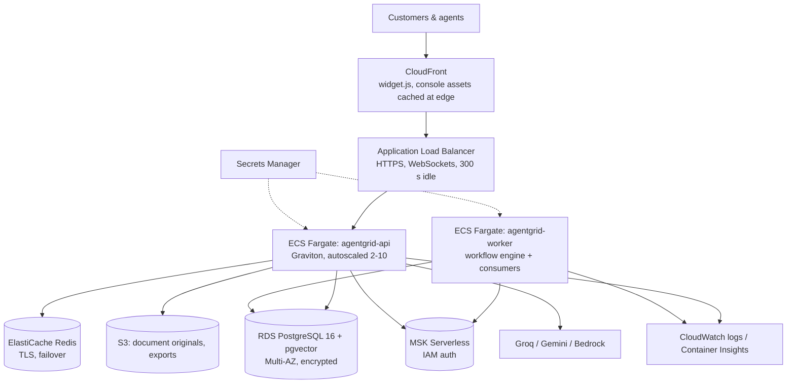

# Deployment

This guide covers two deployments:

1. **Free public deployment** (₹0): Render + Neon (Postgres with pgvector) + Upstash (Redis) + Groq/Gemini.
2. **Production reference on AWS**: ECS Fargate, RDS, ElastiCache, MSK, S3, CloudFront and Secrets Manager. It is written as Terraform in `infra/terraform` but has not been deployed.

Both use the same multi-arch Docker image built from the repository's `Dockerfile`.

---

## 1. Free deployment: Render + Neon + Upstash

### 1.1 Create the free resources

1. **Neon** ([neon.tech](https://neon.tech)): create a project on **Postgres 16** and copy the connection string (`postgresql://...@ep-....neon.tech/neondb?sslmode=require`). pgvector is available on Neon, and the first migration runs `CREATE EXTENSION vector`.
2. **Upstash** ([upstash.com](https://upstash.com)): create a Redis database in the region closest to your Render region, and copy the `rediss://default:<password>@<host>:6379` URL.
3. **Groq** ([console.groq.com](https://console.groq.com)): create an API key. Optionally create a **Gemini** key ([aistudio.google.com](https://aistudio.google.com)) for automatic failover.

### 1.2 Create the Render service

1. Push the repository to GitHub. (It's already at `github.com/prateek8741/agentgrid`.)
2. In Render, choose **New → Web Service**, connect the repo, set the runtime to **Docker** and the plan to **Free**.
3. Set these environment variables:

   | Key | Value |
   |---|---|
   | `APP_ENV` | `production` |
   | `DATABASE_URL` | your Neon URL |
   | `REDIS_URL` | your Upstash `rediss://` URL |
   | `JWT_SECRET` | `python -c "import secrets; print(secrets.token_urlsafe(48))"` |
   | `SUPERADMIN_EMAIL` / `SUPERADMIN_PASSWORD` | your own values (the defaults are rejected in production) |
   | `PUBLIC_BASE_URL` | `https://<your-service>.onrender.com` |
   | `CORS_ORIGINS` | `https://<your-service>.onrender.com` |
   | `FORWARDED_ALLOW_IPS` | `*`. Render's proxy is the only thing that can reach the container, so trusting it is safe here. Never do this on a public port. |
   | `RUN_MIGRATIONS` | `true` (runs `alembic upgrade head` on boot) |
   | `GROQ_API_KEY` (+ optional `GEMINI_API_KEY`) | your keys |
   | `DB_POOL_SIZE` / `DB_MAX_OVERFLOW` | `3` / `2` (stays within Neon's free connection limit) |

4. Set the health check path to `/ready`.
5. Deploy. Then load the demo data **from your own machine**, pointed at the same Neon database. Render's free plan has no shell, and seeding locally also computes the embeddings locally:
   ```bash
   # macOS / Linux
   DATABASE_URL='<neon url>' REDIS_URL='' python scripts/dev.py seed
   # Windows PowerShell
   $env:DATABASE_URL='<neon url>'; $env:REDIS_URL=''; py scripts/dev.py seed
   ```
   The command prints the demo logins.
6. Open `https://<your-service>.onrender.com` for the console, `/docs` for the API, and `/demo/sunrise-dental` for the widget demo.

### 1.3 Cold starts and free-tier notes

- **Render free services sleep after about 15 minutes of inactivity.** The first request afterwards takes roughly 30–60 s while the container starts. The embedding model is baked into the image (`PRELOAD_EMBEDDINGS=true`), so no download is added to that time. Before a demo, open `/health` once to wake the service. A free uptime pinger can keep it warm during evaluation windows.
- **Neon** also suspends idle compute. Its first query takes about 0.5–2 s and then it is fast. The app enables `pool_pre_ping` and recycles connections, so suspended connections are handled transparently.
- **Upstash free tier** limits commands per day/month. AgentGrid uses about 3–6 Redis commands per message (rate limit, lock, memory, pub/sub), which is ample for demos.
- **Groq free tier** limits tokens per minute. On `openai/gpt-oss-120b` the limit measured on 2 Nov 2026 was **8,000 tokens per minute**, roughly 6–7 grounded answers a minute. A batch simulation hit it. On a 429 the router fails over to Gemini automatically, so **add a free `GEMINI_API_KEY` for demos with several people**. Alternatively, set `GROQ_MODEL` to a model with a higher limit (for example `qwen/qwen3.8-27b`). Rules-handled turns (greetings, flows, handover) use no LLM tokens. If every provider is exhausted, agents keep working in rules-only mode.
- **Workers:** on the free plan the workflow engine and event consumers run inside the web process (`RUN_WORKERS_IN_API=true`, the default).

### 1.4 Hugging Face Spaces (alternative)

Create a **Docker** Space from the repository. Set the same variables as Space secrets, and set `PORT=7860`; the server reads `PORT`. Spaces also sleep when idle.

### 1.5 WhatsApp in production

Point the Meta webhook to `https://<host>/webhooks/whatsapp` and set `WHATSAPP_APP_SECRET`, `WHATSAPP_VERIFY_TOKEN` and `WHATSAPP_ACCESS_TOKEN`. Then set `whatsapp_phone_number_id` on each tenant, under Console → Settings → Channels. For a demo, `CHANNELS_DEFAULT_TENANT` is enough. See the README for the step-by-step Meta setup.

---

## 2. Production reference architecture on AWS (designed, not deployed)



| Component | AWS service | Notes |
|---|---|---|
| API | **ECS Fargate** (ARM64/Graviton) behind an **ALB** | 2+ tasks across 3 AZs; CPU target tracking (60%); deployment circuit breaker with rollback; `/ready` health checks |
| Workers | **ECS Fargate** service running `python -m app.workers` | Workflow engine and event consumers. Scale on Kafka consumer lag. |
| Database | **RDS PostgreSQL 16** with the `vector` extension | Multi-AZ, encrypted, forced SSL, 14-day backups, Performance Insights. Add a read replica for analytics. |
| Cache / pub-sub | **ElastiCache Redis 7** | TLS, automatic failover |
| Event bus | **MSK Serverless** (Kafka API) | IAM authentication; same code path as Redpanda |
| Files | **S3** (KMS-encrypted, public access blocked) | Document originals and exports |
| Edge | **CloudFront** | Caches `widget.js` and the hashed console assets globally; API and WebSocket pass through uncached |
| Secrets | **Secrets Manager** | Injected into tasks as environment variables; never stored in task definitions |
| Observability | CloudWatch Logs and Container Insights; Amazon Managed Prometheus/Grafana optional | The app already exposes `/metrics` and OpenTelemetry hooks |
| Region | `ap-south-1` (Mumbai) | Data residency for Indian customers |

The Terraform is in [`infra/terraform`](../infra/terraform): VPC, security groups, RDS, ElastiCache, MSK, S3, Secrets Manager, ECR, ECS (API and worker), ALB, autoscaling and CloudFront. Kubernetes equivalents (Deployments, HPA, PDB, Ingress, migration Job) are in [`infra/k8s`](../infra/k8s).

### Rollout

1. `terraform apply`, then fill the LLM and Meta secrets in Secrets Manager.
2. CI builds the multi-arch image and pushes it to ECR with an immutable tag.
3. A one-off ECS task runs `python -m app.cli migrate`.
4. Update the ECS services. Deployments are rolling, and the circuit breaker rolls back automatically.
5. Point DNS at CloudFront.

### Indicative monthly cost (small production, ap-south-1)

| Item | ≈ USD / month |
|---|---|
| Fargate: 2 × (1 vCPU, 2 GB) API + 1 × (0.5 vCPU, 1 GB) worker, ARM | 80 |
| RDS db.t4g.medium Multi-AZ, 50 GB | 130 |
| ElastiCache cache.t4g.small × 2 | 50 |
| MSK Serverless (low throughput) | 60–100 |
| ALB + CloudFront + NAT + S3 + logs | 70 |
| **Total (excluding LLM usage)** | **≈ 400–450** |

You can roughly halve this by using a single-AZ database, a single NAT gateway and Redpanda on Fargate in non-production environments.
